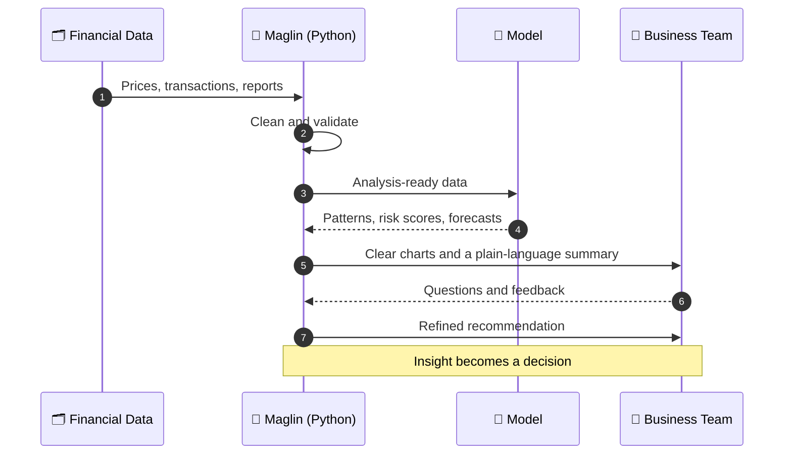
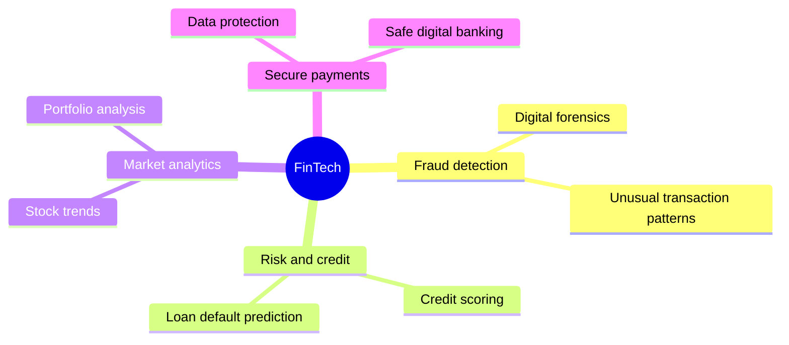

<!-- ================================================================
  GITHUB PROFILE README  |  Maglin Vithusha
  REPLACE THESE 2 THINGS BEFORE PASTING:
  1) YOUR-EMAIL-ADDRESS  ->  your email (appears 2 times)
  2) YOUR-LINKEDIN-URL   ->  your LinkedIn profile link (appears 2 times)
  Profile repo name must be exactly your GitHub username: maglin997
================================================================= -->

**B.Tech Artificial Intelligence & Data Science**
St. Joseph's College of Engineering, Chennai

<a href="YOUR-LINKEDIN-URL">🔗 <b>LinkedIn</b></a> &nbsp;&nbsp;|&nbsp;&nbsp;
<a href="mailto:YOUR-EMAIL-ADDRESS">✉️ <b>Email</b></a> &nbsp;&nbsp;|&nbsp;&nbsp;
<a href="https://github.com/maglin997">💻 <b>GitHub</b></a>

---

## 📌 Executive Summary

> I am an AI and Data Science student who wants to work where numbers meet decisions: **FinTech**. I enjoy using Python and data analysis to understand financial and business problems, and I am also drawn to **digital forensics**, because protecting financial data matters as much as analysing it.

 

## 🧾 Profile at a Glance

| Item | Details |
|---|---|
| **Name** | Maglin Vithusha |
| **Programme** | B.Tech Artificial Intelligence & Data Science |
| **Institution** | St. Joseph's College of Engineering, Chennai |
| **Programming languages** | C, Python, Java |
| **Career direction** | FinTech: data science applied to finance and business |
| **Technical interest** | Digital forensics |
| **Languages** | English, French |

 

## 🔄 How a Data Project Reaches a Decision

This is the conversation I want every project to have, from raw numbers to a business decision.

 

## 💹 Where My Interests Meet

Finance, data and security overlap in more places than people expect. This map shows the areas of FinTech I want to explore.

 

## 🧰 Skill Portfolio

| Skill area | Applied to | Stage |
|---|---|---|
| 🐍 **Python** | Data handling, analysis and simple financial calculations | Growing |
| ☕ **Java** | Object-oriented programming and small banking-style applications | Learning |
| ⚙️ **C** | Programming logic and problem solving | Foundation |
| 📊 **Data science** | Cleaning, exploring and visualising data | Learning through coursework |
| 🕵️ **Digital forensics** | Basics of investigating and securing digital evidence | Exploring |
| 🇫🇷 **French** | Communicating across languages | Learning |

 

## 📂 Project Pipeline

| Project | What it is | Tech | Status |
|---|---|---|---|
| 📈 **stock-trend-analysis** | Analyse historical share prices, daily returns and moving averages | Python | 🟡 Planned |
| 🏦 **bank-management-system** | Console banking app with accounts, deposits, withdrawals and statements | Java | 🟡 In progress |
| 💳 **fraud-detection-basics** | Spot unusual transactions in a sample dataset | Python | ⚪ Starting |
| 🔎 **forensics-learning-log** | Notes and beginner exercises on digital forensics | Notes | 🔵 Ongoing |
| ⚙️ **c-programming-practice** | Practice programs covering logic, arrays and strings | C | 🔵 Ongoing |

Rename these to match the repositories you actually create.

 

## 🎯 Goals

**Short-term**
- Achieve good academic results.
- Improve my communication skills and self-confidence.
- Gain practical knowledge and take part in college activities.

**Long-term**
- Build a career in FinTech, using data science to help organisations make sound financial and business decisions.
- Combine my analytical skills with an understanding of finance, risk and security.

 

## 💬 Let's Connect

I am happy to talk about **Python, Java, data science, FinTech and digital forensics**, and to collaborate on beginner-friendly projects.

- ✉️ **Email:** [maglinvithusha@gmail.com](mailto:YOUR-EMAIL-ADDRESS)
- 🔗 **LinkedIn:** [Maglin Vithusha](https://www.linkedin.com/in/maglin-vithusha-285a92432/)

*"Good decisions begin with good data."*

